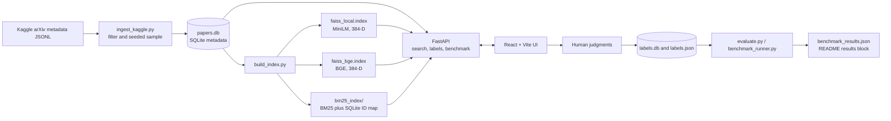

# ArXivLens

ArXivLens is a local hybrid search application for discovering machine-learning and AI research papers in an arXiv metadata corpus. It combines semantic vector retrieval, lexical BM25 retrieval, and Reciprocal Rank Fusion (RRF), and includes a React interface for search, side-by-side comparison, human relevance labeling, and benchmark reporting.

This README describes the implementation and the **verified local dataset/index/benchmark snapshot as of 2026-11-02**. Generated databases, indexes, model caches, and the raw Kaggle file are local artifacts and are not distributed through Git.

## Contents

- [Features](#features)
- [Architecture](#architecture)
- [Dataset and corpus](#dataset-and-corpus)
- [Embedding and index details](#embedding-and-index-details)
- [Search and ranking](#search-and-ranking)
- [Application and API](#application-and-api)
- [Install and run](#install-and-run)
- [Rebuild the corpus and indexes](#rebuild-the-corpus-and-indexes)
- [Labeling workflow and ground truth](#labeling-workflow-and-ground-truth)
- [Evaluation method and measured results](#evaluation-method-and-measured-results)
- [Project files and generated artifacts](#project-files-and-generated-artifacts)
- [Verification](#verification)
- [Limitations and interpretation](#limitations-and-interpretation)

## Features

- Search paper titles and abstracts with **BM25**, **FAISS dense vectors**, or **Hybrid RRF**.
- Select the MiniLM or BGE dense embedder when both local indexes are available.
- Compare hybrid results with BM25 results and see list overlap and method-unique papers. Overlap measures agreement, not correctness.
- Open arXiv records, inspect authors/date/category metadata, and expand abstracts.
- Label a fixed, blind, persistent candidate pool for each benchmark query. The interface supports keyboard shortcuts, automatic advance, skip, undo, per-query progress, and export.
- Evaluate retrieval with Recall@K, NDCG@K, per-query outcomes, latency, model/index sizes, and a paired bootstrap interval.
- Run the complete application locally on Windows; the normal search path does not call an external embedding API.

## Architecture



The API loads the indexes and embedding models once during startup. It keeps the paper database read-only for searches and stores benchmark judgments separately in `labels.db`.

## Dataset and corpus

### Source and local file

The corpus was built from the Cornell University Kaggle [arXiv Dataset](https://www.kaggle.com/datasets/Cornell-University/arxiv), using its `arxiv-metadata-oai-snapshot.json` JSON-lines metadata file. The local copy used for ingestion was **5,667,572,509 bytes** (about 5.28 GiB). The source file remains in `data/`; `data/` is ignored by Git because the snapshot is large. The corpus stores paper metadata, not PDF or full-text content. To reproduce from a fresh checkout, download the dataset from Kaggle in a browser, unzip it, and place `arxiv-metadata-oai-snapshot.json` in the project `data/` directory; the ingestion script does not download the dataset.

### Filtering and sampling that produced `papers.db`

The executed full import scanned **3,233,620 JSONL lines**. It kept records that:

1. Parse as JSON objects and contain an arXiv `id`, non-empty `title`, non-empty `abstract`, and a parseable publication date.
2. Have at least one category in `cs.AI`, `cs.LG`, or `cs.CL`.
3. Have a first-version publication year of 2018 or later. The importer reads `versions[0].created`, with `update_date` as a fallback if needed.

There were **449,941 matching records**. The importer used reservoir sampling with seed `42` to select **150,000** of them, giving matching records an equal chance of selection without holding the source file in memory. A 5,000-paper trial import was also run before the full import. The kept rows were sorted by publication date and arXiv ID before insertion. SQLite `id` values are local integer keys; `arxiv_id` remains the stable paper identifier.

Text values are whitespace-normalized (including newlines). Authors are limited to 500 characters by the importer. The database includes the original category string and constructs `https://arxiv.org/abs/<arxiv_id>` links.

### Verified corpus snapshot

`papers.db` currently contains **150,000 rows**, covering publication dates **2018-01-01 to 2026-10-29**. The year distribution is:

| Year | Papers |
|---:|---:|
| 2018 | 5,111 |
| 2019 | 8,176 |
| 2020 | 11,122 |
| 2021 | 12,237 |
| 2022 | 13,570 |
| 2023 | 17,044 |
| 2024 | 22,391 |
| 2025 | 28,175 |
| 2026 (through Oct 29) | 32,174 |
| **Total** | **150,000** |

Each paper can have multiple arXiv categories, so category counts overlap and must not be added together as if they were exclusive buckets.

| Category membership | Papers carrying the category |
|---|---:|
| `cs.LG` | 93,192 |
| `cs.AI` | 65,443 |
| `cs.CL` | 38,691 |
| `cs.CV` (cross-listed) | 24,260 |
| `stat.ML` (cross-listed) | 20,511 |
| `cs.CR` (cross-listed) | 6,231 |
| `cs.RO` (cross-listed) | 6,132 |
| `cs.IR` (cross-listed) | 4,859 |

The first three categories define the import filter. Other categories remain in each paper's metadata when a selected paper is cross-listed. The current database occupies about **268.39 MiB**.

### SQLite schema

`papers.db` contains one `papers` table:

| Column | Meaning |
|---|---|
| `id` | `INTEGER PRIMARY KEY AUTOINCREMENT`; local identifier used by FAISS and the API |
| `arxiv_id` | `TEXT NOT NULL UNIQUE`; original arXiv identifier |
| `title` | `TEXT NOT NULL`; whitespace-normalized title |
| `abstract` | `TEXT NOT NULL`; whitespace-normalized abstract |
| `authors` | `TEXT NOT NULL`; author string from the source, limited to 500 characters |
| `categories` | `TEXT NOT NULL`; space-separated arXiv category metadata; may contain cross-lists |
| `published` | `TEXT NOT NULL`; ISO `YYYY-MM-DD` publication date |
| `url` | `TEXT NOT NULL`; arXiv abstract URL |

## Embedding and index details

### Dense indexes

Two local Sentence Transformers models were indexed over the same 150,000 title-plus-abstract documents:

| Index tag | Model | Dimensions | Vectors | Build time recorded | FAISS file size |
|---|---|---:|---:|---:|---:|
| `local` | `sentence-transformers/all-MiniLM-L6-v2` | 384 | 150,000 | 5,342.6 s (about 1 h 29 min) | 220.87 MiB |
| `bge` | `BAAI/bge-small-en-v1.5` | 384 | 150,000 | 10,988.7 s (about 3 h 3 min) | 220.87 MiB |

Documents are encoded as `title + ". " + abstract`. Embeddings are stored as normalized `float32` vectors. Each FAISS index is `IndexIDMap(IndexFlatIP)`, which performs exact inner-product search and stores the corresponding SQLite integer IDs. With normalized vectors, inner product is cosine similarity. BGE adds the prefix `Represent this sentence for searching relevant passages: ` to **queries only**, not to corpus passages.

`build_index.py` embeds in chunks of 2,000 by default. Completed chunks are saved atomically in `emb_cache/`, validated against model/database fingerprints, and reused after an interrupted build. A five-document dense self-check was recorded as 5/5 for both full indexes.

The resume behavior was exercised: a probe build was interrupted after two of 75 chunks, and the subsequent full build logged reuse of `chunk_0.npy` and `chunk_2000.npy` before embedding the remaining chunks.

### Sparse index

The `bm25s` index tokenizes the same title-plus-abstract corpus and removes English stopwords. It contains 150,000 documents and is saved under `bm25_index/`. Its `doc_ids.npy` array maps the BM25 document positions back to the exact SQLite integer IDs. The whole sparse index directory occupies **123.56 MiB**; its title-retrieval self-check was recorded as 5/5.

### Active data artifacts and sizes

| Artifact | Purpose | Verified size/count |
|---|---|---:|
| `papers.db` | Paper metadata and stable SQLite IDs | 150,000 rows; 268.39 MiB |
| `faiss_local.index` | MiniLM dense index | 150,000 vectors; 220.87 MiB |
| `faiss_bge.index` | BGE dense index | 150,000 vectors; 220.87 MiB |
| `bm25_index/` | Sparse BM25 data, vocabulary, and SQLite ID map | 150,000 IDs; 123.56 MiB |
| `labels.db` | Human judgments and persistent candidate pools | 16 queries; 815 judgments |
| `labels.json` | Portable export of the human judgments | 815 judgments |
| `benchmark_results.json` | Full machine-readable benchmark output | 16 evaluated queries |

`papers.db`, the FAISS files, and `bm25_index/` are local generated artifacts and are not committed. The smaller `*_1k` database/indexes and `faiss_phase2_check.index` are legacy demo/check artifacts; they are not used by the current application.

## Search and ranking

### Retrieval modes

- **Dense:** encode the query with the selected model and search its normalized FAISS inner-product index.
- **Sparse:** tokenize the query with the BM25 English-stopword configuration, retrieve BM25 document positions, and map those positions through `doc_ids.npy` to SQLite IDs.
- **Hybrid:** retrieve the top 50 dense and top 50 sparse IDs, then combine the rankings using Reciprocal Rank Fusion:

  `RRF(d) = sum(1 / (60 + rank))`

  Ranks start at 1. The two lists contribute independently; duplicate paper IDs accumulate both contributions. Results are sorted by descending fused score, with SQLite ID as a deterministic tie-breaker.

Metadata is fetched from SQLite in retrieval order. Compare mode reports shared results and results unique to each list. Its overlap percentage is `shared / max(list lengths)`; this is list agreement, not a relevance metric.

### Embedding providers

`embeddings.py` defines a common `BaseEmbeddingProvider` interface with `embed_texts(texts)`, `embed_query(query)`, and `get_dimension()`. Providers return L2-normalized `float32` NumPy vectors. `LocalSentenceTransformerProvider` is the current default; `OpenAIEmbeddingProvider` is available as an optional implementation of the same interface. No OpenAI embedding index or OpenAI benchmark was built for this verified snapshot. Using that provider requires an API key, an OpenAI index with a matching embedding model/dimension, and may incur API charges.

## Application and API

### React interface

The Vite/React UI provides:

- Search box, preset topics, top-K control, and Hybrid/Dense/Sparse selector.
- MiniLM/BGE selector when both indexes are loaded.
- Two-column Hybrid vs BM25 comparison with shared/unique results and overlap summary.
- Paper cards with linked title, authors, publication date, category pills, and expandable abstract.
- Human labeling tab with a blinding-preserving single candidate list, progress per query, strict relevance guidance, keyboard controls, skip/undo, and label export.
- Benchmark tab showing aggregate and per-query scores, model/index size and build time, latency, and uncertainty/win-tie-loss summaries.
- Loading, empty, and backend-error states.

`VITE_API_URL` configures the API base address. It defaults to `http://127.0.0.1:8000` to match Uvicorn's IPv4 bind.

Search offers `Hybrid`, `Dense`, and `Sparse` modes, Top K choices 5, 10, or 20, and preset searches for LoRA fine-tuning, FlashAttention GPU optimization, and Vision Transformer patch projection. The embedder selector is shown when more than one dense index is available.

### FastAPI routes

| Route | Purpose |
|---|---|
| `GET /` | Service name and local UI/API-doc links |
| `GET /embedders` | List loaded dense models |
| `POST /search` | Dense, sparse, or hybrid search; accepts query, method, top K, and embedder |
| `POST /compare` | Hybrid and BM25 lists plus overlap counts |
| `GET /benchmark/queries` | List benchmark queries and progress |
| `POST /benchmark/queries` | Add or edit a query |
| `GET /labels/pool?query_id=...` | Read the stored blind pool and its current judgments |
| `POST /labels/pool/refresh` | Append newly retrieved candidates for one query |
| `POST /labels/pool/refresh-all` | Build/extend pools for every query |
| `GET /labels?query_id=...` | Read a query's judgments |
| `POST /labels` | Save or update a Relevant/Not relevant judgment |
| `DELETE /labels` | Undo/remove a saved judgment |
| `POST /labels/export` | Export judgments to `labels.json` |
| `POST /benchmark/run` | Run the human-labeled benchmark through the shared runner |

The API enables CORS for local frontend development. It validates requests and returns client errors for invalid inputs and server errors for retrieval/database failures.

Example search request from PowerShell:

```powershell
$body = @{ query = "low rank adaptation for language model fine-tuning"; method = "hybrid"; top_k = 10; embedder = "bge" } | ConvertTo-Json
Invoke-RestMethod -Method Post -Uri "http://127.0.0.1:8000/search" -ContentType "application/json" -Body $body
```

`method` accepts `dense`, `sparse`, or `hybrid`; `embedder` accepts a loaded dense tag such as `local` or `bge` (sparse search is independent of the dense model). Search results include the query, method, embedder, and ordered paper metadata.

## Install and run

The current environment was verified with Python 3.13.9, Node.js 20.20.2, and npm 10.8.2. Python packages in `requirements.txt` include `arxiv`, `bm25s`, `faiss-cpu`, `fastapi`, `numpy`, `openai`, `pydantic`, `sentence-transformers`, `tqdm`, `uvicorn`, `pytest`, and `ruff`. Frontend dependencies include React, Vite, Tailwind CSS, and Lucide React; exact frontend dependency versions are locked by `package-lock.json`.

From PowerShell in the project directory:

```powershell
python -m venv .venv
.\.venv\Scripts\Activate.ps1
python -m pip install --upgrade pip
python -m pip install -r requirements.txt
npm ci
```

Start both backend and frontend together:

```powershell
python run.py
```

`run.py` starts Uvicorn on `127.0.0.1:8000`, starts Vite on `127.0.0.1:5174`, waits for both services to answer, opens the UI and API documentation, and keeps the parent terminal open. Keep that terminal open while using the application; press **Ctrl+C** there to stop the services.

- UI: <http://localhost:5174>
- Interactive API docs: <http://127.0.0.1:8000/docs>
- Health/service links: <http://127.0.0.1:8000/>

If activation scripts are disabled for the current PowerShell session, run `Set-ExecutionPolicy -Scope Process Bypass` and activate the environment again. The running API loads local models and indexes at startup; the first startup can take longer while model files are initialized.

### Startup and connection troubleshooting

- Open **port 5174** for the React application. Port 8000 is the JSON API; `/docs` is its interactive OpenAPI page.
- Start `python run.py` from this repository's root and leave its terminal open. The launcher waits for both services before opening links.
- If the UI reports that it cannot reach the API, check that Uvicorn is running on `127.0.0.1:8000`, Vite on `127.0.0.1:5174`, and `VITE_API_URL` is correct. If another process is already using either port, stop it or change the port values in `run.py` and set a matching `VITE_API_URL` before launching Vite.
- A cold start initializes both embedding models and reads the large local indexes. Keep the startup terminal open to see Python/model errors; the browser's API docs link can confirm that the backend started.

### Configuration

| Variable | Default | Use |
|---|---|---|
| `VITE_API_URL` | `http://127.0.0.1:8000` | Frontend API base URL (set before `npm run dev`/build) |
| `PAPERS_DB` | `papers.db` | Paper SQLite database |
| `FAISS_INDEX` | `faiss_local.index` | Default dense index |
| `FAISS_BGE_INDEX` | `faiss_bge.index` | Optional BGE index; loaded if the file exists |
| `BM25_INDEX` | `bm25_index` | Sparse BM25 directory |
| `FAISS_OPENAI_INDEX` | `faiss_openai.index` | Optional OpenAI-backed dense index path |
| `OPENAI_API_KEY` | unset | Enables the optional OpenAI model only when a matching index exists |
| `OPENAI_EMBEDDING_MODEL` | model recorded in index stats, otherwise `text-embedding-3-small` | Optional OpenAI embedding model |
| `LABELS_DB` | `labels.db` | Human label database |
| `LABELS_EXPORT` | `labels.json` | Label export path |
| `ARXIVLENS_STARTUP_TIMEOUT` | `180` seconds | Maximum startup wait in `run.py` |

## Rebuild the corpus and indexes

The current Kaggle JSONL file is local and ignored by Git. A fresh checkout needs the dataset file placed at `data\arxiv-metadata-oai-snapshot.json` before the import step. The importer itself does not download data.

```powershell
# Import the seeded 150,000-paper sample (this replaces papers.db when --overwrite is used).
python ingest_kaggle.py `
  --input data\arxiv-metadata-oai-snapshot.json `
  --db papers.db `
  --max-papers 150000 `
  --min-year 2018 `
  --categories cs.AI cs.LG cs.CL `
  --seed 42 `
  --overwrite

# Build MiniLM dense + BM25 indexes. Model files must already be cached for offline-only runs.
python build_index.py --chunk-size 2000 --local-files-only

# Build BGE dense index without rebuilding BM25.
python build_index.py `
  --model BAAI/bge-small-en-v1.5 `
  --tag bge `
  --skip-bm25 `
  --local-files-only

python status.py
```

The `--local-files-only` flag makes a rebuild fail clearly if model files are missing from the Hugging Face cache. Remove that flag only when a permitted model download is intended. The BGE model was downloaded once and then built locally. `build_index.py` saves resumable embedding chunks in `emb_cache/`; allow substantial disk space and time. The recorded full-corpus builds took approximately 89 minutes for MiniLM plus BM25 and 183 minutes for BGE on the machine used here; actual time depends on CPU, disk, and cached-model state.

The current FAISS files use about 442 MiB combined, and the BM25 files use about 124 MiB. The database and raw JSONL corpus take substantially more space. Keep a free-space margin for temporary embedding chunks and index writes when rebuilding.

### Optional OpenAI index

`OpenAIEmbeddingProvider` supports `text-embedding-3-small`, but this is **not** part of the offline default or the current measured results. Building it sends corpus text to the OpenAI API and may incur charges:

```powershell
$env:OPENAI_API_KEY = "your-api-key"
python build_index.py --provider openai --model text-embedding-3-small --tag openai --skip-bm25
$env:FAISS_OPENAI_INDEX = "faiss_openai.index"
python run.py
```

For later app sessions, also keep `OPENAI_API_KEY` set. The API only exposes that embedder when both the configured index file and key are present. Keep credentials in environment variables; do not commit secrets. The app does not load `.env` files automatically.

### Importer alternative

`ingest.py` is a smaller alternative that queries arXiv directly using the `arxiv` Python package. It searches `cat:cs.AI OR cat:cs.LG OR cat:cs.CL`, accepts a configurable result limit, cleans newlines/whitespace, and ignores duplicate `arxiv_id` values. The active 150,000-row corpus described here was created by `ingest_kaggle.py`, not by that API importer.

## Labeling workflow and ground truth

The human ground truth covers **candidate papers**, not the entire 150,000-paper corpus. For each query, the pool builder takes the union of top-20 results from BM25 and from each loaded dense and hybrid system. The pool is persisted in `labels.db`, receives a deterministic query-seeded order, and only grows when refreshed. The UI does not reveal which system contributed a paper.

The current pools contain 815 unique query-paper candidates across 16 queries. All 815 candidates have been judged: **542 Relevant and 273 Not relevant**. Pool sizes range from 34 to 60 papers per query (average about 51), so labeling did not require reviewing all 150,000 papers. The list below is the current label snapshot; `judged / pool` is complete for every query.

| # | Benchmark query | Pool / judged | Relevant |
|---:|---|---:|---:|
| 1 | making large models run on phones | 46 / 46 | 17 |
| 2 | teaching AI to say it doesn't know | 56 / 56 | 3 |
| 3 | making neural networks smaller without losing accuracy | 56 / 56 | 31 |
| 4 | reducing hallucinations in chatbots | 57 / 57 | 44 |
| 5 | learning from very few examples | 57 / 57 | 41 |
| 6 | explaining why a model made a decision | 51 / 51 | 44 |
| 7 | training models without labeled data | 60 / 60 | 12 |
| 8 | AI that improves its own reasoning step by step | 56 / 56 | 35 |
| 9 | LoRA | 54 / 54 | 53 |
| 10 | FlashAttention | 52 / 52 | 12 |
| 11 | Mamba state space model | 51 / 51 | 49 |
| 12 | RLHF | 44 / 44 | 36 |
| 13 | retrieval augmented generation | 52 / 52 | 51 |
| 14 | mixture of experts routing | 40 / 40 | 40 |
| 15 | diffusion models image synthesis | 49 / 49 | 42 |
| 16 | graph neural networks molecular property prediction | 34 / 34 | 32 |
| **Total** | **16 queries** | **815 / 815** | **542** |

In the Label tab, judge relevance consistently: mark Relevant only when the paper's main topic directly addresses the query. A paper that merely mentions the words in passing should be Not relevant. `R` marks Relevant, `N` marks Not relevant, `S` skips without saving a judgment, and `Z` undoes the previous action. Judgments are saved to `labels.db` as they are made; export with the UI button or:

```powershell
python export_labels.py
```

`labels.db` has three tables: `benchmark_queries` (query ID and text), `pool` (query ID, arXiv ID, first-seen time, and stable position), and `labels` (query ID, arXiv ID, binary relevance, and labeled time; one judgment per query-paper pair). `labels.json` is keyed by benchmark query and records each arXiv ID, binary relevance value, and timestamp. When `labels.db` is first initialized, an existing `labels.json` is restored into it. The real judgments and export are included in this project snapshot; never substitute automatically generated labels for human review.

## Evaluation method and measured results

### Metrics and assumptions

The evaluator runs each eligible query through BM25, MiniLM dense/hybrid, and BGE dense/hybrid retrieval.

- **Recall@K** = relevant retrieved in the first K results divided by the total number of known Relevant papers for that query.
- **DCG@K** = `sum(rel_i / log2(i + 1))` for result positions `i = 1..K`, where `rel_i` is binary (`1` if Relevant, otherwise `0`).
- **NDCG@K** = DCG@K divided by the ideal DCG for the same number of known relevant papers, capped at K.
- Reported Recall and NDCG values are macro-averages across queries with at least one Relevant label. Queries with no Relevant label are excluded; the current snapshot has none excluded.
- Every system's top-10 results for the evaluated queries are covered by the saved pools (`pool_coverage=up_to_date`). Papers without a Relevant judgment are treated as not relevant, as is standard for this pooled-judgment benchmark.
- Query latency is the mean measured search time per eligible query on the current machine. It is hardware- and warm-cache-dependent, not a service-level guarantee.
- The 95% interval is a seeded, paired bootstrap over query-level **Hybrid local minus BM25 NDCG@10** differences, using 1,000 resamples and seed 42.

### Current results

The following table and interpretation are generated from `benchmark_results.json`; do not hand-edit metric values. To regenerate after changing labels or indexes, run `python evaluate.py --save benchmark_results.json` and then `python scripts/update_readme_results.py`.

<!-- RESULTS:START -->
| Method / embedder | Recall@5 | Recall@10 | NDCG@5 | NDCG@10 | Latency (ms) | Index size (MiB) |
|---|---:|---:|---:|---:|---:|---:|
| BM25 | 12.14% | 26.11% | 0.7732 | 0.7711 | 5.48 | 123.56 |
| Dense MiniLM | 10.89% | 20.55% | 0.7280 | 0.7202 | 54.60 | 220.87 |
| Hybrid MiniLM | 11.80% | 21.45% | 0.7890 | 0.7403 | 60.63 | 220.87 |
| Dense BGE | 12.46% | 21.85% | 0.8195 | 0.7801 | 65.28 | 220.87 |
| Hybrid BGE | 16.09% | 26.60% | 0.8605 | 0.8108 | 66.35 | 220.87 |

Hybrid MiniLM Recall@10 lift over BM25: **-17.8%**.
Hybrid BGE lift over BM25: Recall@10 **+1.9%**, NDCG@10 **+5.2%**.

Mean paired NDCG@10 difference (Hybrid MiniLM vs BM25), 95% bootstrap CI (1,000 resamples): **[-0.1140, 0.0502]**.

Evaluation used **16 queries, 815 judgments, 1 labeler, pooled judgments**.

NDCG@10 wins/ties/losses (Hybrid MiniLM vs BM25): **5/5/6**.

Across these 16 queries, BM25 Recall@10 was 26.11% and NDCG@10 was 0.7711. Hybrid MiniLM Recall@10 was 21.45% and NDCG@10 was 0.7403. Hybrid BGE Recall@10 was 26.60% and NDCG@10 was 0.8108.

<!-- BENCHMARK_RESULTS_SHA256:da4ae349b8ad8e2790388ebb8b68d754a69463555619ae0a36a85c29f33a324f -->
<!-- RESULTS:END -->

The evaluation used one human labeler and a pooled set of retrieved candidates. These results describe this corpus, these 16 queries, and these judgments; they do not establish general performance across all arXiv papers or research topics.

## Screenshots and qualitative review

The screenshots show the real local UI, including the completed benchmark page:

- [Overlap banner](docs/screenshots/overlap-banner.png) — compare mode on a concept query.
- [Side-by-side comparison](docs/screenshots/compare-mode.png) — Hybrid and BM25 result columns with overlap summary.
- [Benchmark tab](docs/screenshots/benchmark-tab.png) — measured metrics and per-query results.

[`docs/qualitative_checks.md`](docs/qualitative_checks.md) records top-10 Hybrid/BM25 overlaps and method-unique titles for five queries: `medical`, `LoRA`, `making large models run on phones`, `teaching AI to say it doesn't know`, and `reducing hallucinations in chatbots`. It is qualitative evidence, not an accuracy score.

## Reproduce the human-labeled benchmark

With the local API and indexes available, the GUI Label tab is the recommended way to add or correct judgments. The command-line sequence after judging papers is:

```powershell
python export_labels.py
python evaluate.py --save benchmark_results.json
python scripts/update_readme_results.py
python status.py
```

The API's Benchmark tab runs the same `benchmark_runner.py` code path as `evaluate.py`. The runner writes the full JSON record, including UTC timestamp, methods and embedders, aggregate metrics, per-query metrics, latency, index sizes/build times, judgment counts, bootstrap metadata, and pool-coverage warnings. Do not manually edit the generated Results block: the SHA-256 marker lets `status.py` confirm that it matches `benchmark_results.json`.

### Procedures completed for this snapshot

| Stage | Evidence from the local run |
|---|---|
| Kaggle import | 5,000-paper trial and full 150,000-paper run; full run scanned 3,233,620 lines and matched 449,941 records |
| MiniLM and BM25 | 150,000 dense vectors, 150,000 BM25 IDs, dense self-check 5/5, BM25 title self-check 5/5 |
| Resume check | Build resumed after interruption and reused the first two saved MiniLM chunks |
| BGE index | 150,000 vectors, 384 dimensions, dense self-check 5/5 |
| API smoke run | Dense, sparse, hybrid, compare, BGE embedder, exact-title and nonsense sparse queries exercised against the local corpus; API log records successful search/compare responses |
| Pool lifecycle | Scratch-database check restarted the API and confirmed pool order and two sample judgments persisted; the real label database was not used for test judgments |
| Human labeling | 815 real query-paper judgments across all 16 query pools: 542 Relevant, 273 Not relevant |
| Evaluation and docs | CLI benchmark saved; label export generated; README result block and three UI screenshots generated |
| Final project check | `status.py`: 12/12 done; unit tests: 16 passed; frontend production build completed |

Phase output and smoke logs remain locally in the ignored `logs/` folder and are not included in Git. Summary artifacts include `benchmark_results.json`, `labels.json`, `docs/qualitative_checks.md`, and the screenshots; `index_stats.json` and the corpus/index files are local generated artifacts.

## Project files and generated artifacts

| File/folder | Role |
|---|---|
| `ingest_kaggle.py` | Streaming JSONL importer with category/date filters and seeded reservoir sampling |
| `ingest.py` | Optional arXiv API importer for smaller samples |
| `embeddings.py` | Swappable normalized local Sentence Transformers and OpenAI embedding providers |
| `build_index.py` | Chunked/resumable FAISS and BM25 index builder, ID mapping, build stats, and self-checks |
| `search_engine.py` | Validates index/database ID alignment and implements dense, sparse, hybrid, and metadata retrieval |
| `main.py` | FastAPI lifecycle and search, comparison, label, pool, export, and benchmark endpoints |
| `labels_store.py` | SQLite schema, query/label/pool persistence, label import/export |
| `pool_builder.py` | Fair pooled candidate construction and coverage checks |
| `overlap.py` | Comparison-list agreement statistics |
| `metrics.py` | Recall, DCG/NDCG, and deterministic bootstrap math |
| `benchmark_runner.py` | Shared labeled benchmark implementation for API and CLI |
| `evaluate.py` | Command-line benchmark runner and JSON output |
| `export_labels.py` | Command-line export to `labels.json` |
| `run.py`, `start.bat` | Windows app launchers |
| `src/` | React application and styles |
| `scripts/qualitative_checks.py` | Generate the retrieval comparison notes in `docs/qualitative_checks.md` |
| `scripts/update_readme_results.py` | Regenerate the marked README results section from benchmark JSON |
| `scripts/api_smoke.py`, `scripts/pool_lifecycle_smoke.py` | API and persistent-pool smoke checks |
| `status.py` | Check local corpus, index counts, human labels/coverage, result freshness, README marker, screenshots, and tests |
| `tests/` | Unit tests for retrieval metrics, labeling/pools, evaluation, overlap, and results generation |
| `requirements.txt` | Python dependencies |
| `package.json`, `package-lock.json`, `vite.config.js`, `tailwind.config.js`, `postcss.config.js`, `index.html` | Frontend dependencies and build configuration |
| `PROJECT_MAP.md` | Short source/artifact map and cleanup notes |

Large or regenerated local artifacts are excluded from Git by `.gitignore`: `data/`, `papers*.db`, `*.index`, `bm25_index*/`, `emb_cache/`, `index_stats.json`, logs, Python environments/caches, `node_modules/`, and build output. `labels.json`, `benchmark_results.json`, source code, docs, and screenshots are versioned for this completed project snapshot.

## Verification

Run the project checks from the repository root:

```powershell
python status.py
python -m pytest -q
npm run build
```

For the completed snapshot, the last Definition-of-Done check reported **12 of 12 done, 0 failed, 0 blocked on human input**. The unit suite reported **16 passed**, and the frontend production build completed successfully. `status.py` compares paper/index counts, verifies index-to-SQLite mappings and build stats, checks label and pool completeness, validates exports/results freshness and the README results hash, and checks screenshot presence.

## Limitations and interpretation

- This is a seeded random **2018+ sample** of papers intersecting three arXiv category filters, not the complete arXiv corpus or a manually balanced benchmark set.
- Human judgments come from one labeler. Pooled evaluation makes the task practical, but labels are not exhaustive relevance judgments over every paper in the 150,000-paper corpus.
- All results are specific to the current 16 queries and sampled candidates. The confidence interval is for Hybrid local vs BM25 NDCG@10 only, and should not be treated as proof of a general performance gain.
- Unjudged results are counted as non-relevant. Pool coverage is complete for the systems and top-10 cutoffs recorded here; if an index or retrieval system changes, refresh the pools and relabel newly added candidates before trusting a new benchmark.
- MiniLM and BGE encode title plus abstract; long inputs may be truncated at each model's token limit.
- Full index construction is CPU/disk intensive. Build times depend on hardware, storage, batch configuration, and whether model/embedding chunks are cached.
- The OpenAI provider is optional and was not part of the current offline index or measured benchmark.
